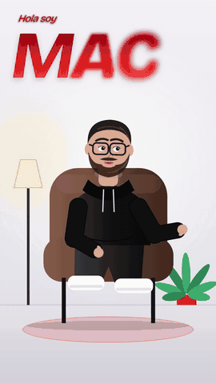
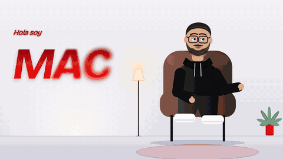
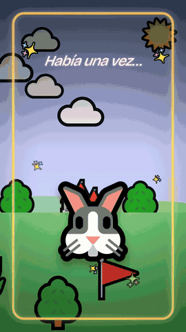
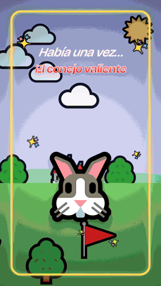
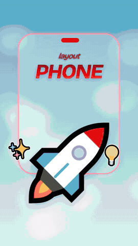
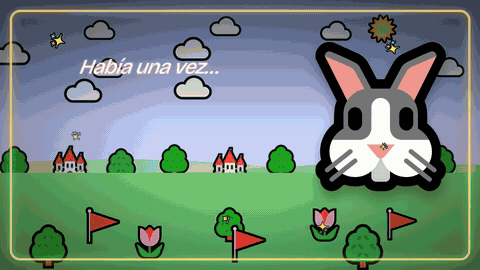

# Crimson Gloss — skill para Claude Code

Dale a Claude Code **un video tuyo hablando a cámara** —o solo **un guion**— y te devuelve el reel **ya editado**, con un informe que te explica **todo lo que hizo y por qué**.

Tiene cuatro modos (normal, crimson, personaje y **cuento infantil**):

| | **Normal** | **Crimson** |
|---|---|---|
| Para qué | Dejar un video listo para redes, rápido y limpio | Un reel con estilo de motion design (texto 3D rojo, tarjetas, efectos) |
| Quién lo decide | Todo automático (3 comandos) | Claude diseña las escenas **a partir de lo que dices** |
| Qué hace | Corta silencios · subtítulos palabra a palabra · zooms de énfasis · rótulo con tu nombre · llamada a la acción · música baja · volumen -14 LUFS | Texto rojo cristal 3D al ritmo de la voz · tarjetas y cintas que salen **por detrás de ti** · píxeles y halftone · escenas inserto que ilustran lo que dices |
| Demo |  |  |

### Modo personaje (sin cámara)
Solo un **guion** (o tu voz) → un presentador **animado por código**: sincronía labial por visemas, parpadeo, mirada, respiración, **gestos de brazos y manos** (contar con los dedos, señalar, saludar…), cámara con parallax, set con lámpara/planta, y todo el estilo Crimson con tarjetas que salen **por detrás** del personaje. Escenas guiadas por lo que dice el guion (palabra clave + emoji que la ilustra), 1:1 + SRT y volumen -14 LUFS.



Y en horizontal (16:9), con el texto a la izquierda y el personaje a la derecha:



> Las demos usan un presentador dibujado con código (no una persona real) para no usar material de nadie. Con tu video, la persona eres tú.

---

### Modo cuento (cuentos infantiles y educativos)
Un guion de cuento → **video ilustrado**: portada «Había una vez…», páginas con el texto **resaltado palabra a palabra** mientras se narra, ilustraciones animadas con **12 mundos** (bosque, mar, espacio, castillo, nieve…) y personajes (~80 animales y figuras) que caminan, vuelan, nadan o saltan según el verbo, **globos de diálogo**, escena de magia, **moraleja** y «FIN». También contenido educativo: **contar, letras, formas y colores**, y mapa del tesoro.



Todos los layouts de cuentos, educativos y generales:



### Catálogo de B-roll (37 tipos)
Las escenas a pantalla completa no son una sola plantilla: `phone`, `stat` (número que cuenta), `chart` (línea/barras), `steps`, `checklist`, `compare`, `quote`, `chat`, `browser`, `terminal`, `grid`, `meter`, `rain`, `notifs`, `rating`, `image` (tu foto con zoom) y `clip` (tu video); más **generales** (`split`, `timeline`, `headline`, `polaroids`, `price`, `callout`, `progress`, `countdown`, `reaction`) y **de cuentos y educativos** (`scene`, `storybook`, `title`, `theend`, `moral`, `speech`, `counting`, `letter`, `shapes`, `journey`, `magic`). Guía con fuentes: [reference/broll-guide.md](crimson-gloss/reference/broll-guide.md). En modo personaje se **eligen solos según lo que dice el guion** («creció 300 %» → cifra animada, «entra a tusitio.com» → navegador que escribe la URL y hace clic, «primero, segundo, tercero» → pasos…). Detalle y parámetros en [docs/COMO_FUNCIONA.md](docs/COMO_FUNCIONA.md#9-catálogo-de-b-roll).



### Vertical y horizontal
Todo funciona en **9:16** (Reels, TikTok, Shorts) y en **16:9** (YouTube, presentaciones). Los cuentos, el B-roll y el **personaje animado** se recomponen de verdad para pantalla ancha (cuento: ilustración a la izquierda y texto a la derecha; B-roll y personaje: titular grande a la izquierda y el visual o el presentador a la derecha). 

Elige con `--orientation horizontal` o cambia solo al renderizar: `render.py work --orientation horizontal`.

## Instalar (1 comando)

**Windows (PowerShell):**
```powershell
irm https://raw.githubusercontent.com/Macc961112/crimson-gloss/main/install.ps1 | iex
```
**Mac / Linux:**
```bash
curl -fsSL https://raw.githubusercontent.com/Macc961112/crimson-gloss/main/install.sh | bash
```
Instala la skill en `~/.claude/skills/crimson-gloss` y las dependencias de Python. **Necesitas** tener ya: Python 3.10+, Node 18+ y FFmpeg. Reinicia Claude Code después.

Instalación manual: copia la carpeta [`crimson-gloss/`](crimson-gloss) a `~/.claude/skills/` y ejecuta `pip install -r requirements.txt`.

## Usar

En Claude Code, dale la ruta de tu video:

- `Edítame este video: C:\videos\yo.mp4` → modo **normal**
- `Hazme un cuento infantil de un conejo valiente que ayuda a un zorro` → modo **cuento**
- `Hazme un video de 40 s sobre cómo ahorrar, con un muñeco animado` → modo **personaje** (escribe el guion, la voz y el video)
- `Ponle subtítulos y quítale los silencios` → modo **normal**
- `Hazlo estilo crimson` / `tipo crimson` → modo **crimson**
- `/crimson-gloss C:\videos\yo.mp4`

Claude hace el resto: prepara el video (o escribe el guion y la voz), planifica, **te enseña unos fotogramas de prueba**, renderiza y te **explica todo** con `informe.md`. Para cambiar algo, se edita `plan.json` y se vuelve a renderizar (no hace falta repetir todo).

**Mejor resultado:** graba en vertical, con buena voz y poco ruido. Para el modo Crimson, **fondo blanco o liso**: así las tarjetas pueden salir por detrás de ti.

## Qué pasa por dentro (resumen)

```
 tu video ──► prepare.py ──► transcript.json + input.mp4 (+ cutout.webm en crimson)
                              │   · pasa a 1080x1920 · transcribe en TU máquina (faster-whisper)
                              │   · (normal) corta silencios y reajusta los tiempos
                              ▼
                   plan.json  ◄── autoplan.py (normal, automático)
                              ◄── Claude lee la transcripción y diseña las escenas (crimson)
                              ▼
                          render.py ──► final.mp4 (-14 LUFS) + informe.md
                              (Remotion = React que dibuja cada fotograma + ffmpeg)
```
Explicación completa, esquema de `plan.json`, posiciones y solución de problemas: [docs/COMO_FUNCIONA.md](docs/COMO_FUNCIONA.md).

## Privacidad
La transcripción es **local**: tu audio no se sube a ningún servicio. Todo el render ocurre en tu ordenador. **Excepción:** en modo personaje la voz sintética (`edge-tts`) envía el **texto** del guion a Microsoft; si no quieres eso, graba tu voz y usa `--audio`.

## Límites (honestos)
- Probado en **Windows** con un clip limpio en español. **No probado todavía con un video real filmado**: el recorte por color puede dejar huecos si llevas ropa del mismo color que el fondo.
- La transcripción local (`small`) se equivoca con **marcas y nombres propios**; Claude las corrige leyendo el contexto (y te pregunta si duda). Opción `--model medium` para más precisión.
- Sin fondo liso, en modo Crimson las tarjetas van **por delante** de ti, no por detrás.
- El personaje es **2D ilustrado**: nunca se verá como una persona filmada ni como video de IA realista.
- Los emojis de las escenas usan la fuente del sistema. Para la mejor calidad, dale imágenes propias.
- La primera vez instala Remotion (1–2 min) y descarga el modelo de voz.

## Estructura
```
crimson-gloss/
  SKILL.md            instrucciones que sigue Claude (los dos modos)
  scripts/prepare.py  video → input.mp4 + transcripción + (corte de silencios | recorte)
  scripts/autoplan.py modo normal: plan automático
  scripts/character.py modo personaje: voz + escenas automáticas + gestos + apariencia
  scripts/lexicon.py  palabra clave → emoji
  scripts/render.py   plan → final.mp4 + informe.md
  template/           proyecto Remotion (Cg.jsx = estilo y cámara; Character.jsx = el personaje y el set)
  reference/style.md  análisis del estilo Crimson Gloss
  examples/           plan.example.json
docs/COMO_FUNCIONA.md documentación completa
```

## Créditos y licencia
Estilo Crimson Gloss inspirado en un reel de @nikhilmotion.vlc; este repo contiene un análisis propio y código original, sin material del reel. Código bajo licencia [MIT](LICENSE). Hecho con [Remotion](https://remotion.dev) (revisa su [licencia](https://remotion.dev/license) si lo usas en una empresa) y [faster-whisper](https://github.com/SYSTRAN/faster-whisper).
